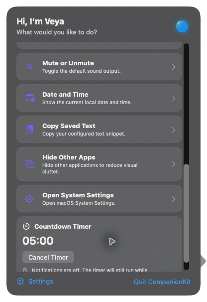
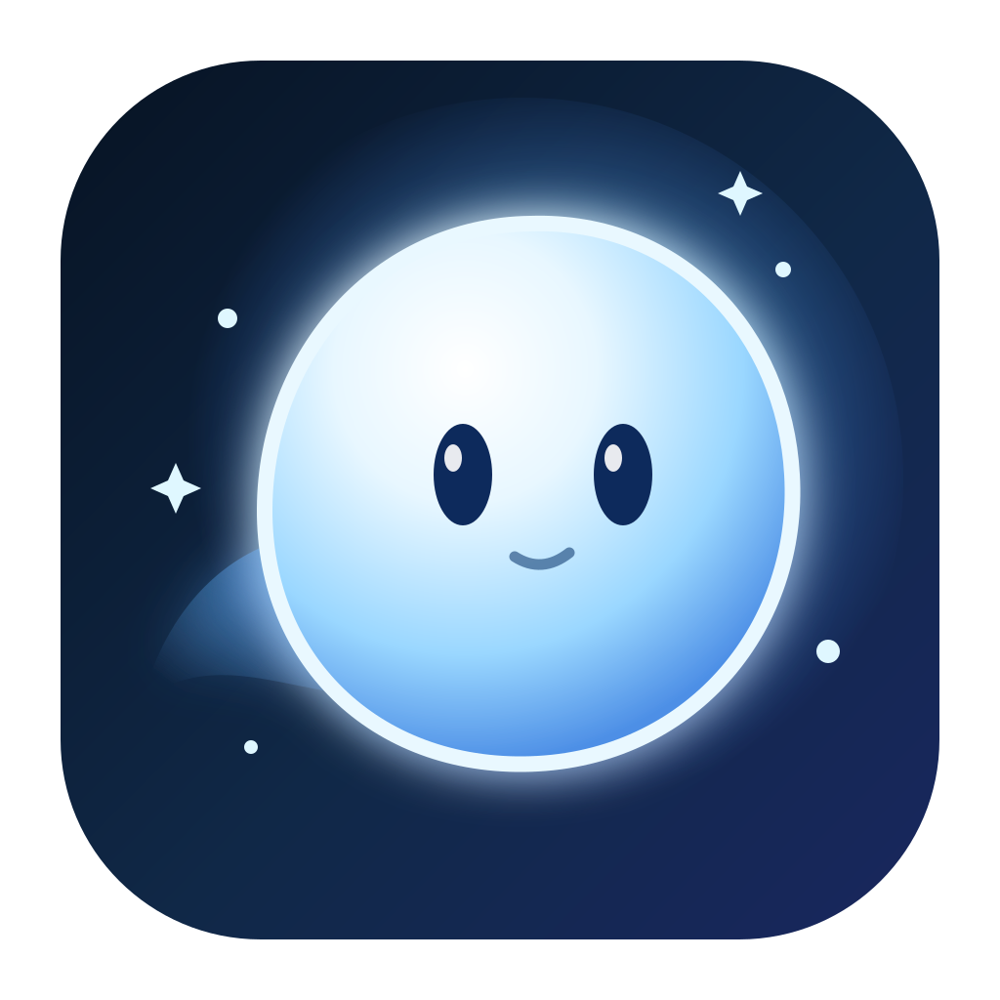

# CompanionKit

> A friendly Mac companion for everyday actions.



[Watch the timer walkthrough](docs/assets/screenshots/timer-walkthrough.gif)

CompanionKit is an open-source native macOS project exploring a small,
customizable desktop pet as an approachable interface to deterministic Mac
actions. The intended experience is calm, transparent, local-first, and useful
without accounts, analytics, advertising, API keys, or an AI service.

The included default companion is **Veya**, an original, wingless Ethereal
soul-orb rendered procedurally with SwiftUI. Veya can be renamed at any time;
the safe deterministic action engine remains the functional core.

## Maintainer and design

Denis Zlatanovic maintains CompanionKit as an independent macOS project.
The design keeps the SwiftUI interface separate from the action registry and
macOS service adapters. The registry describes when an action is available
and whether it needs confirmation. Injected services let tests exercise
failed or denied actions without changing the developer's Mac.

[Explore the architecture and diagrams](docs/ARCHITECTURE.md).

## Project status

**Pre-release developer preview.** The native app, deterministic action set,
timer, settings, onboarding, menu bar, tests, documentation, and CI definition
are implemented. There are currently no published binaries, App Store listing,
signed release, or notarized archive; final accessibility, hardware, permission,
and release validation remains.

## Implemented MVP

- a movable, position-restoring desktop panel with original wingless Veya artwork;
- idle, curious, thinking, working, success, error, sleeping, waiting, surprised,
  and hidden semantic states;
- implemented accessibility semantics and a keyboard-friendly menu-bar alternative,
  with full VoiceOver verification still pending;
- fourteen allowlisted actions implemented with public macOS APIs;
- a local countdown timer with graceful notification-permission handling;
- local settings for name, size, Ethereal color, aura, particles, personality,
  motion, appearance, and shortcuts;
- Veya-focused onboarding and contextual permission explanations;
- transparent errors, 37 deterministic tests, and no simulated success.

Actions open Finder, Downloads, Documents, Desktop, Applications, System
Settings, or a selected app; show the macOS screenshot interface; control volume
where supported; show date/time; hide other apps with confirmation; and copy a
configured snippet. The countdown timer is presented as a dedicated action
card. Unavailable hardware or configuration is explained in the UI.

## Who it is for

CompanionKit is intended for people who prefer visible, named actions over
memorized shortcuts or deep menus, and for Swift contributors interested in
safe native macOS integration. Accessibility is a product requirement, but the
project does not claim conformance or fitness for a particular access need
without documented verification.

## Demo



The screenshot and animated walkthrough at the top of this page use frames
from a locally built, unsigned Xcode developer preview. They show Veya's
action menu, selection of the five-minute preset, and the running countdown.

## Requirements

- macOS 14 or later;
- Xcode 16 or later with a macOS 14 SDK or later;
- a Swift 6-capable toolchain;
- no paid Apple Developer membership for ordinary local Swift Package builds.

## Build and run

Clone the repository using the URL shown by GitHub's **Code** button. Open
`CompanionKit.xcodeproj`, select the shared `CompanionKit` scheme and “My Mac,”
then choose Product > Run. For the secondary SwiftPM development path, run from
the repository root:

```sh
swift build
swift test
swift run CompanionKit
```

See [docs/DEVELOPMENT.md](docs/DEVELOPMENT.md) for exact `xcodebuild` commands,
validation history, and archive guidance. Local development does not imply a
distributable signed app.

## Architecture

The codebase separates:

- reusable domain models, action policy, errors, and service protocols;
- feature UI and state for the pet, actions, timer, onboarding, settings, and
  menu bar;
- AppKit/macOS adapters for windows and system services;
- tests using injected services instead of uncontrolled platform state.

Veya’s semantic state machine is separate from rendering and motion settings.
Ethereal is selected through an internal theme registry, and personality
profiles scale only visual timing and intensity—never action safety.

An action registry is the intended boundary between presentation and
execution. It makes availability, required capabilities, confirmation policy,
structured results, and future extensions visible and testable. See
[the architecture documentation](docs/ARCHITECTURE.md) for implementation details.

## Permissions

CompanionKit requests Notifications only when a user starts a timer and remains
useful after denial. It does not request Accessibility or Screen Recording; the
screenshot action opens Apple's visible Screenshot app. Launch at Login is a
user-controlled `SMAppService` registration and still needs signed-bundle
validation. See [PRIVACY.md](PRIVACY.md) and
[docs/PERMISSIONS.md](docs/PERMISSIONS.md).

## Privacy and security

MVP settings are stored locally using macOS preferences. The design includes no
CompanionKit backend, analytics, ads, accounts, arbitrary command execution, or
mandatory network request. Read [PRIVACY.md](PRIVACY.md) for scope and deletion
guidance. Report suspected vulnerabilities privately as described in
[SECURITY.md](SECURITY.md).

## Current limitations

- The project is not released or production-supported.
- SwiftPM Debug/Release builds and the authoritative unsigned Xcode Debug
  build/test pass with Xcode 26.6; archive, signing, sandbox, entitlements, and
  notarization remain unvalidated.
- Launch at Login, every system action, multi-display behavior, VoiceOver, and
  permission denial/revocation still need final bundled-app manual validation.
- Additional pets, plugin/action packs, natural-language input, localization,
  signed releases, and package-manager distribution are future work.

See [the roadmap](docs/ROADMAP.md) for milestones and explicit non-goals.

## Contributing

Read [CONTRIBUTING.md](CONTRIBUTING.md) and the
[Code of Conduct](CODE_OF_CONDUCT.md) before contributing. Bug, feature,
accessibility, and action-integration issue forms are available on GitHub.

## License

CompanionKit is available under the [MIT License](LICENSE).

## Acknowledgements

CompanionKit is built with SwiftUI, AppKit, and public macOS frameworks. It uses
system visual resources such as SF Symbols where appropriate. Veya, the
procedural renderer, and the vector app icon are original repository-owned work;
future art must remain repository-owned or compatibly licensed.
