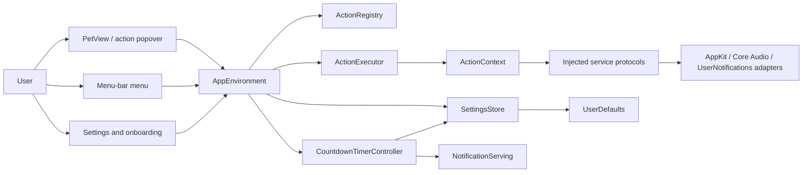
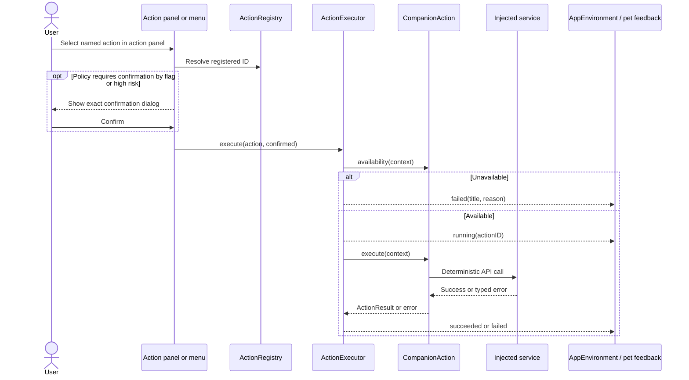

# CompanionKit Architecture

This document describes the current native Xcode application and its secondary
Swift Package build path. CompanionKit is a local-first macOS 14+ accessory
application built with SwiftUI and AppKit. It exposes a fixed set of
deterministic actions and does not contain an account, backend, analytics SDK,
advertising SDK, API key, or AI model dependency.

## System overview

`AppDelegate` creates one `AppEnvironment`, a floating pet window, the menu-bar
controller, and—on first run—the onboarding window. `AppEnvironment` is the
composition root for settings, action registry/executor, timer, live macOS
services, and the pet's feedback state.



All mutable application objects are main-actor isolated. This matches AppKit and
SwiftUI requirements and keeps service calls serialized with UI state changes.

## Source responsibilities

### `CompanionKit/App`

- `CompanionKitApp` declares the SwiftUI app and Settings scene.
- `AppDelegate` configures accessory activation, pet/onboarding/settings window
  controllers, the status item, and navigation closures.
- `AppEnvironment` owns long-lived state, the shared confirmation policy, and
  injected live or test services. It maps action execution to pet states and
  resets success/error feedback after 2.5 seconds.

### `CompanionKit/Core`

- `Models` contains action/pet/settings value types.
- `Protocols` contains `CompanionAction`, `ActionContext`, service protocols,
  and the confirmation-policy helper.
- `Errors` contains `CompanionError` and the mapping from unknown errors to a
  user-facing form.
- `Services/SettingsStore` owns encoded local preferences.
- `Utilities` contains layout tokens, reusable status presentation, and pure pet
  position clamping.

Core declares what the application needs; it does not construct AppKit service
implementations.

### `CompanionKit/Features`

- `Pet` renders the current procedural companion and its semantic state.
- `Actions` defines the allowlisted built-ins, registry, executor, action rows,
  feedback, confirmation UI, and timer card.
- `Timer` contains the pure countdown state machine and its controller.
- `Settings` exposes local preferences and capability controls.
- `Onboarding` explains product, privacy, and notification behavior.
- `MenuBar` exposes keyboard/menu alternatives and quick actions.

### `CompanionKit/Platform/macOS`

- `LiveServices` adapts `NSWorkspace`, `NSApplication`, `NSPasteboard`, Core
  Audio, `UNUserNotificationCenter`, and `SMAppService` to Core protocols.
- `PetWindowController` owns the transparent `NSPanel`, popover, movement,
  display selection, and position persistence.
- `OnboardingWindowController` owns the first-run AppKit window.
- `SettingsWindowController` owns the reusable native Settings window instead
  of relying on an undocumented selector.
- `Resources/Assets.xcassets` contains the original app icon and accent-color
  catalog used by the Xcode application target. SwiftPM excludes the asset
  catalog.

Some UI/controller code still invokes narrow platform globals directly for app
termination, the application picker, and opening Notification Settings. New
action behavior should continue to enter through the registry and injected
service boundary.

## Registered actions and services

| Action | Category | Adapter/capability | Availability or confirmation |
| --- | --- | --- | --- |
| Open Finder | Places | `WorkspaceServing` / application launching | Always offered; adapter reports launch failure |
| Open Downloads | Places | `WorkspaceServing` / file-system location | Fails if the user Downloads URL cannot be resolved or opened |
| Open Documents | Places | `WorkspaceServing` / file-system location | Fails if the user Documents URL cannot be resolved or opened |
| Open Desktop | Places | `WorkspaceServing` / file-system location | Fails if the user Desktop URL cannot be resolved or opened |
| Open Applications | Places | `WorkspaceServing` / file-system location | Fails if the local Applications URL cannot be resolved or opened |
| Open Favorite App | Productivity | `WorkspaceServing` / application launching | Requires a stored path that still exists |
| Take a Screenshot | Productivity | `ScreenshotServing` / screenshot interface | Opens Apple's Screenshot app; does not capture directly |
| Volume Up | System | `AudioServing` / system audio | Preflight requires readable scalar volume; write/unmute support is checked during execution |
| Volume Down | System | `AudioServing` / system audio | Preflight requires readable scalar volume; write support is checked during execution |
| Mute or Unmute | System | `AudioServing` / system audio | Preflight requires readable scalar volume; mute support/fallback is checked during execution |
| Date and Time | Productivity | Foundation | No platform capability |
| Copy Saved Text | Productivity | `ClipboardServing` / clipboard | Requires a nonblank configured snippet |
| Hide Other Apps | System | `WorkspaceServing` / application management | Explicit confirmation required |
| Open System Settings | System | `WorkspaceServing` / application launching | Adapter resolves or falls back to the system app path |

The countdown timer is a feature card, not a `CompanionAction`. It uses
`NotificationServing` only after a user starts a timer. Audio availability is
not refreshed automatically when the output device changes; the executor reruns
the readable-volume preflight, and the adapter reports any execution-time
writability/device failure.

## Action execution flow



A nonconfirming menu-bar quick action first opens the action panel, then enters
the executor flow. A quick action that needs confirmation only opens the panel;
the user must select it there before the confirmation dialog appears. This avoids
executing or confirming a state-changing action from a menu redirect alone.

The registry de-duplicates IDs at initialization. `ActionExecutor` rechecks
availability at execution time, transitions through explicit states, and maps
unknown errors to `CompanionError.unexpected`. One
`ActionConfirmationPolicy` instance is shared by the action panel, menu bar, and
executor. It requires confirmation when the action sets
`requiresConfirmation` or has `.high` risk; the executor repeats the check so a
caller cannot bypass it by skipping the UI.

The executor also refuses a second request while its state is `.running`, so
two action service calls cannot overlap and overwrite each other's terminal
feedback. A later selection can run after success/failure replaces the running
state.

## State management

- `SettingsStore.value`, `ActionExecutor.state`,
  `CountdownTimerController.snapshot`, and `AppEnvironment.petState` are
  observable state read by SwiftUI.
- `AppEnvironment` subscribes to executor state using Combine and converts it to
  working/success/error pet feedback.
- Hover can move an idle pet to attentive. Disabling animation moves the pet to
  sleeping; reduced-interaction mode suppresses hover and floating motion.
- `CountdownStateMachine` is a value type. The controller refreshes it once per
  second only while running and cancels its task when the timer ends or is
  cancelled. Reset All Settings calls cancellation before reset; a direct
  controller `reset()` changes state and lets any ticker exit after its next
  wake.
- Pet window position is clamped with the pure `PetPositionClamper` before it is
  stored. Drag-driven writes are debounced by 300 milliseconds.

## Persistence

`SettingsStore` JSON-encodes one `CompanionSettings` value into standard
`UserDefaults` under `companionKit.settings.v1`. Stored fields currently include
personal Veya name, size, last origin, animation, launch-at-login preference,
favorite-app path, app appearance, reduced interaction, clipboard snippet,
onboarding completion, visibility, active timer end date, Ethereal color, aura,
particles, personality, theme, and the user Reduce Motion override. Decoding uses
defaults for newly added fields and migrates the former untouched `Pip` default
to `Veya`.

This data is local preference data, not an encrypted secret store. The active
timer stores an absolute end date so the controller can reconstruct remaining
time after relaunch. The system login-item service remains the source of truth
for whether launch at login is actually enabled; the stored Boolean records the
last successful requested state but the toggle reads `SMAppService` status.

## Permission and process boundaries

Only timer notifications have a runtime authorization request in the current
code. The screenshot action delegates to Apple's visible Screenshot app. There
is no Accessibility API use, Accessibility request, Accessibility entitlement,
Screen Recording capture API, Apple Events automation, or arbitrary script
execution.

Launch at login uses `SMAppService.mainApp`, which requires validation in the
Xcode-built application bundle and can be subject to user approval in System
Settings. The project currently uses bundle identifier
`org.companionkit.CompanionKit`, generated Info.plist settings, and enables the
hardened-runtime build setting. It has no repository-owned entitlements file,
App Sandbox setting, signing team, or verified signed archive. See
`PERMISSIONS.md` for operational details.

## Dependency direction

The intended dependency direction is:

```text
App and Features -> Core abstractions <- Platform adapters
                         |
                         v
                  Local value models
```

`AppEnvironment` is the composition point where the two sides meet. Platform
adapters must not define product policy, and feature UI must not create
unregistered computer-control actions.

## Extension points

### Add an action

Implement `CompanionAction` directly or construct a `BuiltInAction`; declare its
capabilities, risk, confirmation, availability, and typed result; expose any new
OS operation through a Core service protocol and a Platform adapter; register it
in `BuiltInActionFactory`; then add executor/policy/failure tests and update
permission/security documentation.

### Add a service implementation

Conform to the smallest Core protocol and inject it through `AppEnvironment`.
Tests can inject deterministic fakes without touching platform state.

### Add another theme or companion

The internal `CompanionThemeRegistry` currently exposes only the wingless
Ethereal definition. Semantic state, personality, and settings are independent
of the procedural layers in `PetView`. Add a second original theme only after
extracting the smallest renderer boundary needed by real code; do not add a
speculative external plugin runtime.

### Future intent parsing

A future language layer may propose registered action IDs, but it must remain
upstream of deterministic validation, authorization, and execution. It is not
implemented. See `FUTURE_INTENT_ENGINE.md`.

## Current architectural limitations

- `CompanionKit.xcodeproj` and its shared `CompanionKit` scheme are authoritative
  for the app bundle; `Package.swift` remains a secondary CLI build/test path.
- The current bundle identifier and hardened-runtime build setting exist, but a
  signing team, App Sandbox decision, entitlements file, and verified effective
  signature/entitlements do not.
- Launch-at-login behavior has not been validated from a packaged app.
- The temporary QA app's accessibility tree was inspected, but VoiceOver,
  keyboard-only, permission, multi-display, and energy validation remain to be
  recorded.
- The Veya source passes normal SwiftPM Debug and Release builds and 36 tests.
  The authoritative Xcode commands and refreshed Veya UI smoke test must be
  rerun after each visual/state change; see `DEVELOPMENT.md` and
  `../IMPLEMENTATION_PLAN.md` for the latest recorded result.
