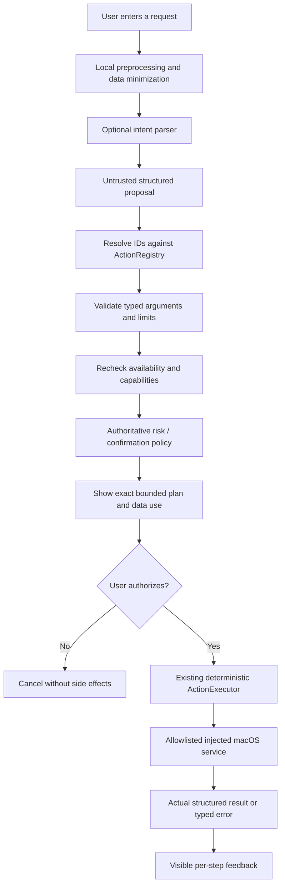

# Future Intent Engine

> Status: architecture exploration only. No natural-language parser, local
> model, cloud model, AI dependency, network request, API key, planner, or
> plugin execution layer is implemented in the CompanionKit MVP.

The purpose of a future intent engine would be to make registered deterministic
actions easier to discover—not to give a model control of the Mac. A parser may
propose a plan. Product policy authorizes it. Existing typed services execute
it. Those responsibilities must remain separate in code and in the UI.

## Required separation of responsibilities

| Layer | Allowed responsibility | Must never do |
| --- | --- | --- |
| Interpretation | Convert user text into candidate intent names and typed argument proposals | Call macOS APIs, invent executable code, or claim an action succeeded |
| Planning | Resolve proposals to registered action IDs and order a bounded plan | Refer to unregistered operations or silently expand user scope |
| Validation | Validate argument schemas, ranges, availability, and current capabilities | Treat model output as trusted or coerce missing sensitive data |
| Authorization | Evaluate risk, show the exact plan/effects, and collect required confirmation | Delegate consent decisions to the model or reuse stale confirmation |
| Deterministic execution | Invoke the existing executor and injected service adapter for each authorized step | Execute shell commands, arbitrary scripts, selectors, URLs, code, or model-generated payloads outside an action schema |
| Reporting | Present actual structured results and stop/continue policy | Rewrite failure as success or hide partial execution |

## Proposed flow

Every edge after the parser treats parser output as untrusted input. The
registry lookup, schema validation, live availability, authorization, and
execution must occur even if the parser is fully local and deterministic.

## Proposal format

A parser should return data, never code. A conceptual proposal contains:

- a versioned proposal schema;
- one or more stable registered action IDs;
- only arguments declared by those actions' versioned schemas;
- a confidence/ambiguity signal used for clarification, never authorization;
- the minimal source-text span that supported each proposed action;
- no pre-authorized or “already executed” flag.

Unknown IDs, unknown fields, invalid enum cases, out-of-range values, excessive
plan length, unavailable capabilities, and schema-version mismatches are hard
validation failures. Free-form strings must have explicit length and character
constraints and must not be reinterpreted by a shell, AppleScript, template
engine, URL handler, or dynamic loader.

The current actions mostly take no arguments; the timer's duration is bounded to
one through 180 minutes in the UI. Future argument schemas should preserve such
product limits rather than exposing raw platform APIs.

## Authorization and plan integrity

- Resolve and validate the whole proposed plan before showing confirmation.
- Preview the exact action names, order, effects, arguments, permissions, and
  personal data that will cross a boundary.
- Ask a clarifying question when intent is materially ambiguous; do not choose a
  more invasive action to avoid asking.
- Require fresh confirmation according to one authoritative policy, including
  every high-risk or destructive step. Confirmation must name the action and
  cannot be embedded in model output.
- Bind authorization to an immutable, canonical plan digest. Any argument,
  action, order, capability, or risk change invalidates it and requires a new
  preview/decision.
- Recheck availability and authorization immediately before every side effect.
- Default multi-step execution to stop on failure. If partial completion is
  possible, say so before confirmation and report exactly which steps ran.
- Never let a parser call `ActionExecutor` or platform services directly.

## Privacy design

Local deterministic parsing should be evaluated first. A future local model or
cloud service is optional and must not become necessary for existing actions.

For any parser:

1. Process only the text the user explicitly submits for interpretation.
2. Do not attach clipboard contents, screenshots, file listings, selected paths,
   action history, accessibility tree content, or other app data by default.
3. Redact or summarize locally before crossing a process/network boundary.
4. Explain whether processing is on-device or external before first use and at
   the point of sensitive disclosure.
5. Obtain explicit opt-in for a cloud provider; provide a fully usable
   deterministic fallback after decline.
6. Define retention, deletion, logging, provider, region, account/API-key, and
   cost behavior before implementation. Update `../PRIVACY.md` before shipping.
7. Do not store prompts or parser proposals as history by default. Diagnostics
   must omit sensitive text unless the user explicitly exports a reviewed,
   redacted report.

A model receives no more information than is necessary to propose an action.
The deterministic executor does not need to send execution results back to a
model; user-visible reporting can be local.

## Threats and required controls

### Prompt injection and adversarial text

Treat all text—including file names or future external content—as data. External
documents must not be silently added to prompts. Parser instructions cannot
override registry, schemas, risk policy, or confirmation.

### Hallucinated or hidden operations

Reject every proposal whose ID is not in the current registry. Display the
canonical registry title/effect, not a model-authored euphemism. The parser
cannot create an action dynamically.

### Argument injection

Use typed decoders with closed schemas, reject unknown fields, normalize before
display, and bind confirmation to the normalized value. No argument may become
a command line, AppleScript, dynamic code, arbitrary file write, or downloaded
executable.

### Plan drift and confused deputy behavior

Authorize one canonical plan and revalidate immediately before execution. Do not
reuse approval across requests, changed state, model retries, or newly available
capabilities.

### Excessive autonomy

Bound plan length and effects. No open-ended loops, “continue until done,”
background monitoring, scheduled recurrence, or self-generated follow-up actions
are allowed without a separately designed, visible user feature and security
review.

### Provider and model updates

Pin/test supported parser versions where possible, keep output contracts
versioned, use a fail-closed decoder, and re-run an adversarial evaluation corpus
before changing a model, prompt, schema, or provider. A remote provider must not
be able to change authorization policy.

## Evaluation before implementation

Build a parser-independent corpus containing:

- direct, paraphrased, misspelled, ambiguous, and unsupported requests;
- requests for prohibited shell/script/download/credential/capture behavior;
- prompt-injection text and attempts to forge confirmation;
- actions unavailable because configuration, permissions, or device capability
  is missing;
- multi-step requests with one failing step;
- personal/sensitive strings that must not leak into logs or cloud requests.

Measure interpretation quality separately from authorization and execution
safety. A parser can be useful only if every invalid proposal is still rejected
by deterministic controls. Red-team and accessibility review must include the
plan preview, clarification, confirmation, partial-failure, and opt-out flows.

## Explicit non-goals

- Direct model control of AppKit, Accessibility, the filesystem, clipboard,
  shell, AppleScript, network clients, or process launching.
- Arbitrary user-authored actions or model-generated plugins.
- Autonomous background computer control or hidden scheduling.
- Replacing the menu/action panel; deterministic actions remain available
  without natural language.
- Shipping external AI in the MVP.

## Adoption gates

Do not begin product integration until the deterministic MVP has passing tests,
recorded permission/accessibility validation, and a reviewed privacy/security
baseline. Preserve the existing authoritative confirmation policy and extend it
only through reviewed deterministic rules. Before release of any intent layer,
require schema and threat-model review, adversarial tests,
provider/data-flow documentation if external, explicit settings and consent,
offline/unavailable behavior, dependency/license review, and updated release
artifacts. Future architecture is not permission to weaken the current
local-first product boundary.
