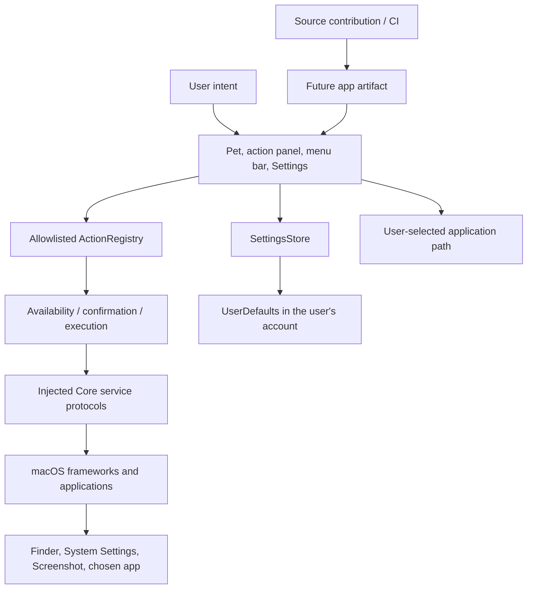

# CompanionKit Threat Model

Last reviewed against the pre-release source: 2026-07-13.

## Scope and security posture

This model covers the native CompanionKit process, its local preferences, the
fourteen registered actions, countdown notification, menu-bar/pet UI, and macOS
service adapters. It does not cover unimplemented intent parsing, plugins,
downloaded action packs, cloud services, or third-party applications opened by
the user.

CompanionKit is a convenience interface running with the privileges of the
logged-in user. It is not a sandbox or a security boundary against other code
already executing as that user. The Xcode project enables the hardened-runtime
build setting and uses a generated Info.plist, but has no App Sandbox setting,
repository-owned entitlements file, signing team, or verified signed archive.

## Assets to protect

- User agency: actions must run only after a visible user choice and required
  confirmation.
- Local preference data: pet identity/position, appearance and interaction
  settings, favorite-application path, clipboard snippet, onboarding state,
  visibility, launch-at-login preference, and active timer end date.
- Clipboard integrity: explicit copying must not become background reading,
  history collection, or silent repeated replacement.
- System state affected by actions: visible applications, default output volume
  and mute state, launched applications, pending timer notification, and login
  item registration.
- Screen/privacy boundary: no hidden screenshot or recording capability.
- Build and update integrity: contributors, CI, dependencies, signing material,
  and eventual release artifacts must not introduce unauthorized behavior.
- Trustworthy feedback: failure, denial, and unavailability must not be reported
  as success.

## Trust boundaries

Crossing from UI to registry must not permit arbitrary operation names. Crossing
from actions to adapters must use narrow typed protocols. `UserDefaults` and
selected paths are local input, not inherently trusted secrets. macOS and any
application CompanionKit opens are external systems with their own behavior.

## Current attack and misuse cases

| Threat | Impact | Current mitigation | Residual risk / follow-up |
| --- | --- | --- | --- |
| Arbitrary shell, AppleScript, or downloaded code execution | Full user-context compromise | No shell/script action, plugin loader, dynamic download, network listener, or code-loading API exists; actions are registered in source | Review every new action and dependency; future extensibility must not add a generic execution escape hatch |
| Hidden or accidental action execution | Unexpected app, clipboard, audio, or window-state change | Named controls, fixed registry, visible executor state, and explicit Hide Other Apps confirmation; menu quick actions open the feedback panel | Low/medium nonconfirming actions still run on one selection by design; risk classification requires review for every new action |
| Confirmation-policy bypass | Higher-risk action runs without intended consent | One policy covers explicit confirmation and `.high` risk in panel, menu, and executor; the executor rejects unconfirmed calls independently | A caller can pass `confirmed: true`, so only trusted first-party presentation should call that path; future plan authorization must bind confirmation to an exact immutable plan |
| Path substitution for favorite app | Launch an unintended local application | Initial path comes from an application-only `NSOpenPanel`; availability and execution resolve symlinks and require an existing `.app` directory with bundle metadata immediately before `NSWorkspace.openApplication` | A same-user process can still modify preferences or replace a valid app bundle. A future sandboxed design should persist and compare a security-scoped bookmark and stable bundle identity |
| Clipboard data exposure or collection | Secret leakage | CompanionKit never reads clipboard contents and stores no history; it only writes the configured snippet after explicit action | The snippet itself is stored unencrypted in `UserDefaults`; users must not store secrets there; copying exposes it to other same-user clipboard readers |
| Hidden screen capture | Exposure of screen content | Screenshot action only opens Apple's visible Screenshot app; no capture API, history, upload, Screen Recording request, or background trigger | The user/macOS controls capture destination and retention after leaving CompanionKit |
| Notification abuse or sensitive lock-screen text | Spam or disclosure | One stable timer request identifier, user-started timer, generic title/body, contextual authorization, and cancellation from Cancel Timer or Reset All Settings | An authorized pending request is designed to outlive the frontmost UI; notification visibility is governed by user macOS settings |
| Permission coercion or denial masking | User loses control or app lies about capability | Only notifications are requested; denial leaves in-app timer running and shows a warning; no Accessibility prompt | Permission UI still needs manual denial/revocation testing in a final app bundle |
| Launch-at-login persistence abuse | Unwanted startup | User-facing toggle calls public `SMAppService`; errors are displayed; status is read from the service; Reset unregisters enabled and pending-approval states | Bundle/signing behavior and System Settings approval are unvalidated. No hidden registration path should be added |
| Local preferences read or tamper | Disclosure or altered behavior | Data is limited to ordinary settings; no credentials/tokens; decode failure falls back to defaults | `UserDefaults` is not encrypted or integrity-protected against same-user code. Do not move secrets into this store |
| Audio/device edge cases | Unexpected volume/mute state or misleading result | Capability check, bounded 6.25-point volume changes, Core Audio status checks, typed errors, and reversible no-mute-property fallback | The fallback remembers the previous volume only in process memory; after relaunch it may restore the 50% default rather than the pre-mute value. Device-specific manual testing remains |
| Resource/energy abuse | Battery drain or degraded performance | No network work or busy loop; timer ticks once per second only while active; tasks are cancelled on completion/cancel/reset; pet animations are subtle and suppressible | No Instruments measurements have been recorded |
| Malicious source contribution | Backdoor, data collection, or weakened policy | Small dependency-free codebase, CI build/tests, review rules, threat/privacy docs, prohibition on secrets and arbitrary execution | CI and review cannot prove absence of malicious behavior. Require focused review for platform, permission, persistence, dependency, and workflow changes |
| Dependency or supply-chain compromise | Build/runtime compromise | No third-party package dependency; GitHub checkout action is pinned to a commit | Apple toolchain, hosted runners, and future dependencies remain supply-chain boundaries; review license, maintainer, update, and security posture before adding any dependency |
| Secret/signing-material leakage | Release compromise | No credentials are needed for CI; documentation prohibits committing certificates, keys, or notarization profiles | Signing/notarization is not configured. Use protected external secret storage and reviewed release approvals later |

## Permission analysis

The only runtime TCC authorization requested by current source is local
Notifications (`alert` and `sound`) when a timer starts. CompanionKit does not
use Accessibility APIs or carry an Accessibility entitlement/configuration. It
does not directly capture the screen, use microphone/camera, monitor input,
send Apple Events, or request Full Disk Access.

Launch at login is a user-controlled service registration, not a blanket
computer-control permission. It must be validated in a properly bundled app and
may require user approval in General > Login Items. See `PERMISSIONS.md`.

## Security invariants for changes

Every contribution must preserve these invariants:

1. A UI or future parser can select only an action already present in the
   registry; it cannot manufacture executable code or service selectors.
2. Arguments are typed, length/range constrained where relevant, and validated
   immediately before execution.
3. Availability and authorization are rechecked at execution time.
4. Confirmation is based on authoritative policy and names the exact effect.
5. Platform adapters expose the smallest operation needed and return truthful,
   typed failures.
6. Permissions are requested in context, explained before use, revocable, and
   not required for unrelated features.
7. Clipboard or screen data is neither collected nor retained incidentally.
8. No account, telemetry, advertising, listener, mandatory network request,
   remote configuration, or downloaded execution is added without a new,
   explicit product/security/privacy review. Downloaded execution remains
   prohibited.
9. No secret, provisioning profile, private key, or sensitive diagnostic log is
   committed or exposed through CI.

## Validation and limitations

- Automated tests can validate action registry/executor, errors, settings,
  timer state, confirmation metadata, and clamping, but cannot establish that a
  macOS permission prompt or every device adapter behaves correctly.
- Manual tests must cover denial/revocation, stale app paths, unsupported audio
  devices, display removal, app relaunch during a timer, Login Item approval,
  and quick-action feedback.
- The current fourteen-action source passed normal SwiftPM Debug and Release
  builds and the authoritative unsigned Xcode Debug build with Xcode 26.6. All
  28 tests passed through both SwiftPM and Xcode. The native app exposed all
  fourteen action rows and core UI in its accessibility tree, and the Date and
  Time action completed successfully. Other real system actions and permission
  prompts were not run; release signing and notarization remain unverified.
- There is no public binary. The project currently uses bundle identifier
  `org.companionkit.CompanionKit` and enables hardened runtime, but the release
  identity, App Sandbox/entitlements, effective signed hardened runtime,
  code-signing, update channel, and release provenance remain unverified.

Revisit this model whenever an action, permission, persisted field, dependency,
entitlement, process boundary, network behavior, plugin/intent layer, signing
workflow, or distribution channel changes.
